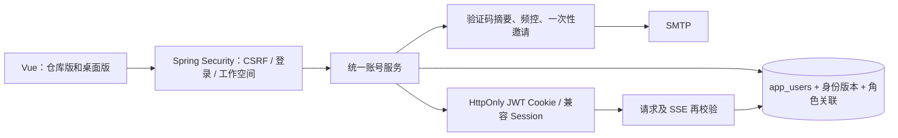
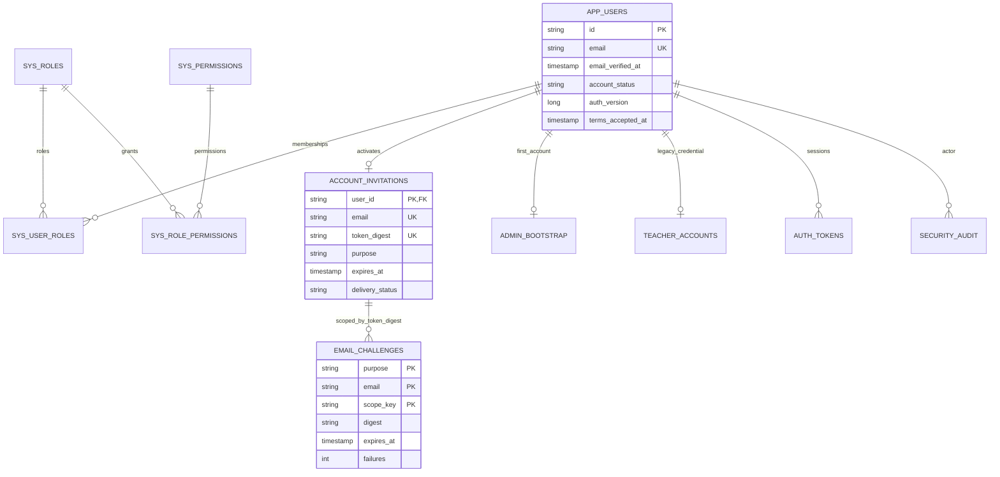
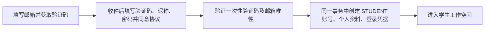
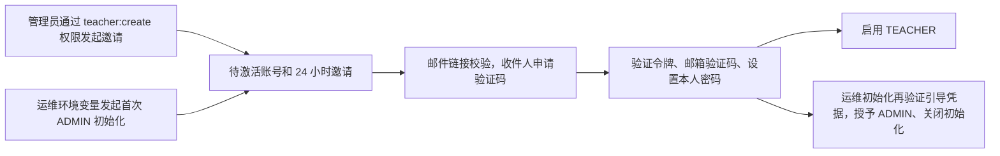
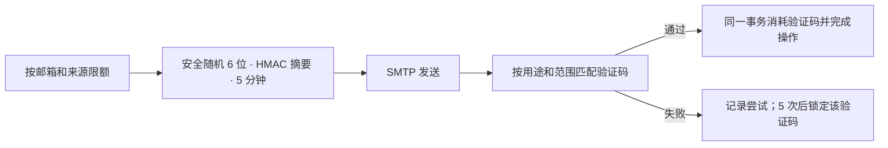
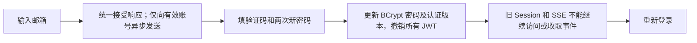
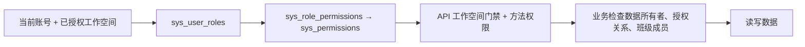

# UniversityAIUser：统一邮箱认证与三角色 RBAC

审计依据见 [第一阶段审计](RBAC-第一阶段审计报告.md) 和 [升级方案](统一邮箱认证与三角色RBAC-升级方案.md)。本次在原有 Spring Boot、Spring Security、MyBatis、Flyway、Vue/Pinia 和 API 契约之上增量升级。系统只有 STUDENT、TEACHER、ADMIN 三个工作空间；账号可以拥有多个角色。

## 认证架构

## 数据库 ER 图

邀请与验证码以摘要标记用途范围；审计操作人和账号的连线表示逻辑关联。验证码和邀请都不存明文。限额表 `email_send_quota` 存散列后的邮箱/IP 计数，`identity_locks` 协调并发操作，`managed_settings` 存放后台配置。

## 学生注册

## 老师账号发放和首位管理员初始化

取消和重发撤销原令牌。后台展示投递失败，允许重发。激活的验证码与邀请分别生成，旧链接无法使用新的验证码。首位管理员的环境配置只发起邀请且预留账号；验证邮箱并提交初始化凭据后才授予 ADMIN。成功后删除部署环境中的初始化凭据。后续管理员由拥有完整授权的管理员向已验证的用户分配，不能公开注册或给自己添加角色。

## 验证码和找回密码

验证码 60 秒冷却跨自然分钟；每邮箱每小时 5 次/每天 10 次，每来源每小时 30 次/每天 100 次。邀请与验证码共享邮件配额，收到邀请后若立刻请求验证码，需等 60 秒冷却。重置邮件发送给未知/禁用邮箱时不披露账号状态。更换邮箱需要当前密码和新地址验证码，并尽力向旧邮箱发送通知。

## 三角色权限判定

权限每次请求读取数据库；角色移除、禁用、密码或邮箱变更使旧凭据不可用。SSE 发事件或心跳前再次检查。ADMIN 面向平台治理，不能通过 ADMIN 工作空间访问学生私有 AI 对话、计划等数据；老师仍需具备指导授权或班级范围。最后一名有效管理员及其必要管理权限受数据库事务保护。

## 接口与管理操作

完整请求体、响应和错误码见 [OpenAPI](../contracts/openapi.json)。以下路径省略 `/api/v1`；写请求须先从 `GET /session/csrf` 获取 CSRF 标头。

| 接口 | 用途 |
| --- | --- |
| POST `/auth/login`、`/session/login` | 同一邮箱及密码校验，分别兼容 JWT Cookie 和 Session |
| GET `/auth/me`；POST `/auth/workspace`、`/auth/logout`、`/session/logout` | 获取权限、切换已授权工作空间及退出 |
| POST `/auth/email/code`、`/auth/register`、`/auth/password/reset` | 发码、学生注册、三角色统一找回 |
| POST `/auth/invitation/check`、`/auth/invitation/activate` | 邀请状态与一次性激活 |
| POST `/auth/email/change-code`、`/auth/email/change` | 发送变更邮箱验证码、确认绑定 |
| GET `/admin/users`、`/admin/users/{id}`、`/admin/users/legacy` | 按邮箱/角色筛选、查看用户、查看待认领历史账号 |
| PATCH `/admin/users/{id}`；PUT `/admin/users/{id}/roles` | 修改显示名、分配角色 |
| POST `/admin/users/{id}/disable`、`/admin/users/{id}/enable` | 停用与恢复 |
| POST `/admin/teachers`、`/admin/users/{id}/legacy-binding` | 发放老师及发起历史账号认领 |
| POST `/admin/users/{id}/invitation/resend`、`/admin/users/{id}/invitation/cancel` | 重发与撤销 |
| GET `/admin/roles`、`/admin/permissions`；PATCH `/admin/roles/{role}`；PUT `/admin/roles/{role}/permissions` | 角色目录、权限目录、编辑显示名及权限关联 |
| GET `/admin/audit`；GET/PUT `/admin/settings` | 查询审计；管理平台公告配置 |

后台固定三种业务角色，支持改角色名称和权限关联。文档建议的“新增角色”未开放，因为任意新角色没有对应工作空间，且目标明确为三种角色。账号、角色、授权与配置变更要求填写原因并记录操作人、对象、前后值、时间和请求标识。

## 环境配置与迁移

1. 在部署环境注入 `APP_SMTP_HOST`、`APP_SMTP_PORT`、`APP_SMTP_USERNAME`、`APP_SMTP_PASSWORD`、`APP_MAIL_FROM`，通常使用 587/STARTTLS；`APP_SMTP_AUTH`、`APP_SMTP_STARTTLS` 默认开启，`APP_SMTP_SSL` 默认关闭（仅 465 隐式 TLS 时设 `true`，且必须同时把 `APP_SMTP_STARTTLS` 设为 `false`）。`APP_MAIL_FROM` 必须与 `APP_SMTP_USERNAME` 是同一邮箱，否则多数服务商拒绝投递。测试通过替换邮件适配器捕获验证码。上线前应用实际 SMTP 收件验证投递。

   本机开发不必把凭据写进 IDE 运行配置：`application.yml` 已 `optional:file:./.local-data/mail-local.properties` 导入被 Git 忽略的该文件，模板见仓库根目录同名文件（QQ 邮箱：`smtp.qq.com`、`587`、`APP_SMTP_PASSWORD` 填 16 位授权码而非登录密码）。改完必须重启进程；`SmtpAccountMail` 启动时会以 INFO 打印 `邮件通道已就绪：host:port，发件人 …，加密方式 …`，未配置则 WARN 提示，发信失败时会把 SMTP 原始错误（如 `535 Login fail`、`Authentication failed`）写进日志后仍返回 503 `MAIL_UNAVAILABLE`。
2. 注入随机 `APP_EMAIL_CODE_SECRET`（至少 32 字节，所有实例相同且保密）、`APP_JWT_SECRET` 和外部 HTTPS `APP_PUBLIC_URL`，按环境配置前端来源。在可信网关按真实来源限流；本应用按 Servlet 连接来源限额。
3. 备份真实数据库，在副本上确认 Flyway 版本和业务计数；审阅 [H2 V13](../src/main/resources/db/migration/h2/V13__email_identity.sql) / [MySQL V13](../src/main/resources/db/migration/mysql/V13__email_identity.sql) 后再安排生产迁移。不能沿用用户名登录，切换时应提前通知旧账号重新绑定。迁移不重建现有 RBAC 表、不更新旧 ID，不操作班级、任务、附件或学生私有数据。
4. 设定 `BOOTSTRAP_ADMIN_EMAIL`、`BOOTSTRAP_ADMIN_PASSWORD`（一次性初始化凭据）、`BOOTSTRAP_ADMIN_NAME` 后启动。由收件人打开邀请，等待冷却后取验证码，用初始化凭据和新密码激活。重新启动不会重复创建同一管理员；首次投递失败时等冷却后用相同配置重试，成功后移除初始化凭据。
5. 由管理员在“历史账号”复制待认领清单，请每位用户提供可控制邮箱，核对旧学号/旧用户名等，按原 ID 发起认领。收件人验证邮件验证码、旧账号密码，再设置统一登录密码。新地址已注册、被另一个邀请占用、旧账号所有权不清晰时停止，并由人工核对。不会合并或删除用户。

历史账号迁移报告：本次未访问或迁移真实业务库，因此没有真实账号数、邮箱冲突数或可发布的人员清单。获准在备份/副本上执行后，使用后台 `/admin/users/legacy`（仅限授权管理员）提取清单。旧教师凭据仅用于历史认领，完成后统一查 `app_users`。

## 主要变更文件

| 范围 | 变更 |
| --- | --- |
| 后端认证 | `AuthController`、`SupportController`、`EmailAuthService`、`EmailVerificationService`、`AccountLifecycle`、`JwtService`、`SessionService`、`SessionFilter`、`SecurityConfiguration`、`PermissionService`、`EventService` |
| 管理和邮件 | `AdminController`、`AdminAccounts`、`AdminInitializer`、`AccountMail`、`SmtpAccountMail`、`application.yml`、`.env.example` |
| 数据库 | H2 / MySQL Flyway V13、`EmailAccount`、`IdentityMapper` / `EmailChallengeMapper` 及 XML |
| 两份前端 | `LoginView.vue`、`ActivationView.vue`、`AccountView.vue`、`AdminView.vue`、`ForbiddenView.vue`、客户端 API、界面导航、路由、角色判定、样式、生成的契约类型 |
| 验收 | `EmailSecurityTests`、`EmailSecurityMysqlTests`、已有认证、RBAC、督学和 MyBatis 集成回归、前端 Vitest 与 Playwright |

## 自测与待上线事项

后端：`mvn test`（H2）；在一次性空库或副本启用 `-Dmysql.integration=true -Demail.mysql.integration=true`，验证真实 MySQL。前端：`npm run build`、`npm test`、`npm run test:e2e`。浏览器模拟接口验证界面分流和契约；后端集成测试验证真实认证、数据库和数据范围。

| 验证范围 | 实际结果 |
| --- | --- |
| 后端完整回归（H2 与独立 MySQL 8.0.46） | 82 项通过，旧的样例库往返测试 1 项因未提供专用预置库而跳过 |
| 最终认证专项回归 | H2 与 MySQL 各 9 项通过，包括历史绑定/冲突、首位管理员、撤权、禁用、SSE 和更换邮箱 |
| V12 已有数据迁移到 V13 | H2 演练通过；旧用户 ID、班级成员、指导关系、作业、附件字节、私人会话归属保持不变 |
| OpenAPI 1.5.0 | 138 个接口、1,422 个示例通过校验 |
| 仓库前端 | 构建通过，26 项单元测试通过；全量浏览器套件 52 项通过，随后包含新增管理员用例的认证专项 6 项通过 |
| 桌面前端 | 构建通过，21 项单元测试通过；全量浏览器回归 40 项通过，剩余 2 项模考用例补上加载试卷后复跑通过 |

上线事项：连接实际 SMTP，验收真实投递；在获准后迁移生产库并清点历史账号。找回密码通过有界内存队列统一响应以防枚举，进程重启会丢弃尚未投递的排队任务，用户可在冷却后重试。Apifox 的手工联调使用新版 OpenAPI；仓库里的旧自动化集合尚未改成邮件验证码流程。
