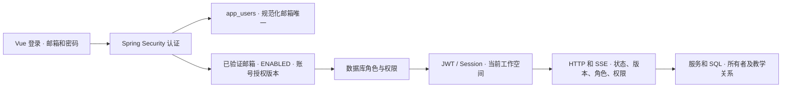

# UniversityAIUser 统一邮箱认证与三角色 RBAC 升级方案

日期：2026-11-12  
阶段：第一步，源码审计与方案评审。

## 1. 当前实现与升级影响

| 范围 | 源码现状 | 升级影响 |
| --- | --- | --- |
| 学生、老师凭据 | `app_users` 保存旧学生登录名和 BCrypt 哈希。V10 将老师凭据写入 `teacher_accounts`。新老师在 `app_users` 仍有业务主体行，登录名和哈希使用占位值。老师和学生的旧登录名可重复，跨表同名不代表同一人。 | 用 `app_users.id` 作为唯一业务主体。现有个人资料、班级、任务、作业及附件外键继续指向原 ID。 |
| 邮箱 | 账号实体及正式账号迁移均无可信邮箱和验证时间。现有注册与老师初始化要求旧登录名为字母、数字或下划线。源码无法推出历史账号的真实邮箱。 | 必须通过受控补录和邮箱验证建立绑定。重复旧登录名和重复候选邮箱分别报告。 |
| 认证入口 | `/auth/login` 依据请求 `role` 查学生或老师凭据，随后查角色授权。旧 `/session/login` 单独验证学生账号，并按会话记录失败次数。JWT、Session 均进入 Spring Security 上下文。 | 复用认证链、BCrypt、JWT Cookie、CSRF。把凭据查询统一为按邮箱，并把旧 Session 登录切到同一认证服务，或在切换时下线旧入口。建议保留路径并统一语义，以兼容仍调用该路径的客户端。 |
| 权限与撤销 | 四张 RBAC 表已存在。普通请求读取当前角色权限。JWT 的 `jti` 有数据库记录，退出只撤销当前凭据。Session 缺少账号版本。SSE 推送前复查 JWT 或 Session 及角色，但缺少订阅权限复查。 | 在认证入口、普通请求、旧 Session 与 SSE 统一验证账号状态和授权版本。角色权限变更后复查权限。 |
| 邮件、密码找回、发放 | 仓库未找到邮件依赖、SMTP 配置、验证码或找回密码服务。老师由启动环境变量开通，匹配旧凭据时可再次补授老师角色。 | 新增可测试的邮件适配器、验证码挑战、邀请和审计。切换时移除旧老师启动开通入口的提权能力。 |
| 两份 Vue 前端 | 仓库和桌面前端都提交登录名和身份，Pinia 持有身份及权限快照。两份前端的契约版本标签相同，操作集合不同。 | 两份分别接入新契约和界面，保留原绿色视觉及各自已有功能。部署前验证实际发布版本。 |

依据：[前一阶段 RBAC 审计](RBAC-第一阶段审计报告.md) · [UserAccount](../src/main/java/com/kaoyan/ai/persistence/entity/UserAccount.java) · [学生账号迁移](../src/main/resources/db/migration/mysql/V1__initial_schema.sql) · [老师凭据迁移](../src/main/resources/db/migration/mysql/V10__teacher_accounts_classes_and_homework.sql) · [AuthService](../src/main/java/com/kaoyan/ai/service/auth/AuthService.java#L48) · [SessionService](../src/main/java/com/kaoyan/ai/service/auth/SessionService.java#L51) · [SessionFilter](../src/main/java/com/kaoyan/ai/api/security/SessionFilter.java#L18) · [EventService](../src/main/java/com/kaoyan/ai/service/task/EventService.java#L147) · [老师初始化](../src/main/java/com/kaoyan/ai/infrastructure/config/TeacherAccountInitializer.java) · [登录页](../frontend/src/views/LoginView.vue#L36)

## 2. 统一身份与会话

- **邮箱。** 建议首版支持常见 ASCII 邮箱，去首尾空格，按 `Locale.ROOT` 统一转小写，按同一规则校验和查询。保留 `+`、点号等合法差异。持久化规范化值，数据库用一致比较规则及唯一索引保证全局唯一。待绑定历史账号使用 `NULL`，已验证状态由验证码或激活事务设置。
- **认证。** 登录只接收邮箱、密码。密码校验后检查邮箱已验证、账号状态和有效角色。角色和权限来自数据库。建议默认优先进入 `ADMIN`、`TEACHER`、`STUDENT` 中首个已授权工作空间。登录后另设已认证的工作空间切换操作，服务端验证目标角色归属、轮换当前登录凭据并返回新权限。跨工作空间时保持现有单角色会话语义，响应同时返回全部已授权角色和当前工作空间权限。
- **失效。** 密码重置、禁用、关键邮箱变更和用户角色调整在事务内递增账号授权版本，并按账号删除 JWT 记录。Session 保存签发时版本，每次使用与数据库比较。切换期无版本的旧凭据按受控切换规则失效。SSE 推送前使用同一策略验证有效身份及订阅权限，并在心跳时处理已撤销连接。恢复账号不会恢复旧凭据。
- **权限。** 固定 `STUDENT`、`TEACHER`、`ADMIN`，保留必要的身份专属路由。业务操作按具体权限检查，并保留个人数据及教学关系边界。角色列表支持编辑说明和动态分配权限，三角色约束下不开放新增角色。后台权限默认覆盖平台管理，私人 AI 对话和学习资料仍按所有者隔离。

## 3. 增量数据库设计与历史账号迁移

### 拟议结构

仓库中的 H2 和 MySQL 迁移均已到 V12。建议从 V13 起成对增加版本，部署前读取目标库的 Flyway 历史确认版本顺序。

| 对象 | 计划变更 |
| --- | --- |
| `app_users` | 增加可空的规范化邮箱及唯一索引、验证时间、账号状态、授权版本。复用现有密码哈希列。待激活账号使用不可用于认证的占位凭据。状态为 `PENDING_ACTIVATION`、`ENABLED`、`DISABLED`。 |
| `teacher_accounts` | 保留表和历史行。旧老师完成邮箱认领时为原用户 ID 写入统一密码哈希。切换后登录仅使用 `app_users`。 |
| `auth_tokens` | 保留现有令牌表，补充按用户索引及批量撤销方法。新凭据附带账号授权版本。 |
| 四张 RBAC 表 | 复用原表和权限关联。增量种入 `ADMIN` 和实际使用的管理权限。权限名称、分类、描述作为管理页可展示的元数据。 |
| 验证码与邀请 | 验证挑战按用途、邮箱和相关用户或邀请绑定，含摘要、过期、失败次数、消费与发送状态。邀请关联待激活用户，含令牌摘要和版本。补充并发限流所需的持久化计数。 |
| 邮件投递、初始化与审计 | 邀请投递状态支持失败和重发。数据库保存一次性管理员初始化标记。角色、权限、账号、邀请及系统配置的管理变更写审计，并使用事务约束关键权限与管理员可用性。 |

既有 Flyway 文件按原版本保留校验和，变更使用新迁移。[Flyway 版本化迁移](https://documentation.red-gate.com/flyway/flyway-concepts/migrations/versioned-migrations)

### 迁移与上线顺序

1. **只读盘点。** 在指定数据库中汇总未绑定邮箱账号、同名历史凭据和候选邮箱冲突，保留原 ID、角色、凭据来源及关键业务引用计数。源结构没有可信邮箱，只有在取得经授权的候选映射后，才能生成真实的邮箱冲突清单。报告按权限查看，邮箱脱敏，密码哈希不导出。
2. **先扩表。** 在空库和历史数据副本分别验证迁移，保留旧字段和旧业务外键。准备经过恢复演练的备份。正式停用旧入口前，按计划给用户提供补录窗口。
3. **受控认领。** 管理员根据原用户 ID 发起绑定。持有人通过既有凭据或经过审核的线下恢复证明账号归属，并验证新邮箱。历史老师使用旧老师凭据证明身份，成功后自行设置统一密码。绑定在事务内提交，唯一索引处理并发冲突。相同用户 ID 若有两套旧凭据，经核实后设置一份新密码。不同用户 ID 若申报同一邮箱，暂停冲突记录并由负责人核对，保持两条历史身份。
4. **切换登录。** 核对真实邮箱绑定率、全部现存关系计数和首个管理员可用性。统一邮箱登录启用后，撤销旧凭据，旧入口停止接收登录名和角色。未补录账号仍保留数据，可走受控认领。
5. **回退边界。** 扩表和新功能可分批发布。生产开始写入新账号、重置密码或切换凭据之后，直接回退到旧登录实现可能使新用户无法登录，或恢复旧认证路径。切换前保留备份、回退窗口与继续向前修复方案。执行切换前评审。

## 4. 注册、验证码、找回密码和邀请

| 流程 | 服务端事务与安全边界 |
| --- | --- |
| 学生注册 | 邮箱验证码挑战校验并一次性消费，创建用户、资料和 `STUDENT` 角色同事务提交，记录用户协议版本和同意时间。严格拒绝请求中的角色字段。并发提交由挑战锁和邮箱唯一约束控制。 |
| 邮箱验证码 | 统一 `EmailVerificationService`，按注册、激活、重置、历史绑定及换绑区分用途。使用安全随机验证码和服务端独立密钥的 HMAC 摘要。默认 5 分钟、同邮箱 60 秒冷却。建议初始配额每邮箱每小时 5 次、每天 10 次，每 IP 每小时 30 次、每天 100 次，每挑战最多 5 次错误尝试。配额可调，跨实例由数据库原子计数。重发使旧挑战失效，错误次数独立提交，避免被业务事务回滚。 |
| 忘记密码 | 邮箱找回申请统一回应。符合条件的账号通过邮件收到重置验证码。消费挑战、更新密码、删除账号全部 JWT、增加授权版本在一个事务提交，完成后重新登录。对外不给出账号是否存在或状态的差异。 |
| 老师发放 | `teacher:create` 创建待激活用户和老师角色关联。待激活状态阻止登录和有效权限，激活后生效。`teacher:invite` 控制重发，`teacher:manage` 控制取消。邀请随机令牌存摘要并绑定用户、邮箱和邀请版本，设置有效期并限制一次消费。 |
| 老师激活 | 邀请链接只打开验证页，邮件预览访问不会消费。按链接定位目标账号，发给同一绑定邮箱的激活验证码用于确认。提交时校验两项挑战并由老师设置密码，同时标记邮箱已验证、启用账号。重发使旧邀请和关联验证码失效。取消保留用户记录及审计，停止旧邀请。 |
| 更换邮箱 | 现有凭据再认证并验证新邮箱，事务内检查唯一性、更新邮箱与账号版本，撤销旧凭据并通知原邮箱。历史补录使用受控认领流程。 |

邮件建议使用 Spring Boot 的 `JavaMailSender`，为 SMTP 配置 TLS、连接超时、读取和写入超时。主机、端口、发件人、授权码、验证码 HMAC 密钥及链接域名由环境配置。测试适配器只在测试或明确的本地配置启用，生产要求真实 SMTP。邀请链接使用配置的受信任 HTTPS 域名。

SMTP 与数据库无法共享事务。老师创建与待投递状态一起落库，提交后投递。系统区分待发、发出、失败；管理员界面看到真实状态，失败可重发并轮换令牌。若采用持久化邮件投递记录，内容中的验证码和邀请链接仅以独立密钥加密、短期保存，确认投递后清理。认证校验表只保存摘要。公开注册可报告实际发送失败。公开找回密码建议统一返回“已受理”，投递失败通过后台状态和告警如实体现；公共队列不可用时统一返回服务不可用。这样能兼顾真实投递状态与账号枚举防护。

参考：[Spring Boot 邮件配置](https://docs.spring.io/spring-boot/reference/io/email.html) · [OWASP 邮箱验证](https://cheatsheetseries.owasp.org/cheatsheets/Email_Validation_and_Verification_Cheat_Sheet.html) · [OWASP 找回密码](https://cheatsheetseries.owasp.org/cheatsheets/Forgot_Password_Cheat_Sheet.html)

## 5. 管理员与管理后台

1. **首次初始化。** 用受控命令或启动配置提供邮箱及一次性初始化材料，验证邮箱后启用管理员。事务锁住数据库初始化标记，创建用户、授予 `ADMIN`、写审计、完成标记一并提交。标记完成后再次运行即拒绝初始化。初始化不使用已存在的普通账号来补授管理员。
2. **授权约束。** 管理 API 校验具体权限。管理权限的授予范围在后端定义，受限管理员无法通过编辑角色—权限、用户角色或系统配置给自己提升权限。账号停用、角色撤销、管理权限编辑用同一事务级锁保护，保持至少一名已验证、已启用、具备必要管理权限的管理员。管理员管理后台开放受控的配置白名单，并隐藏密钥值。
3. **管理功能。** 用户分页、邮箱搜索与详情、禁用与恢复、角色分配、待激活老师及邀请状态、权限目录及角色关联、系统配置、操作日志。日志包含操作者、目标、原因、前后值、时间与请求标识，省略密码、凭据、验证码和邮件令牌。后台由仓库与桌面前端分别接入。

## 6. 实施顺序和验收

| 步骤 | 预计交付 | 验收 |
| --- | --- | --- |
| 1 · 本阶段 | 审计与升级方案 | 确认历史账号认领及数据库切换方案。 |
| 2 | H2/MySQL 增量迁移、统一邮箱登录、账号状态和会话失效 | 空库与旧库升级、三角色登录、待激活与禁用、保留外键及同名旧凭据兼容。 |
| 3 | 邮件验证码基础与学生注册 | 真实校验、伪造角色、重复及并发注册、验证码一次消费。 |
| 4 | 邮件投递、找回密码、邮箱换绑 | SMTP 成功及故障、限流、过期重放、旧 JWT/Session/SSE 失效。 |
| 5 | 管理员一次性初始化和老师邀请 | 开通、过期、撤销、重发、重放、邮件失败可恢复。 |
| 6 | 三角色数据库授权与审计 | 授权后放行、撤销后拒绝、同角色横向越权、权限提权阻断、最后管理员并发保护。 |
| 7 | 管理员 API、后台及两份前端联调 | 同步契约和生成客户端，完成无角色下拉框的登录、注册、找回和激活流程。 |
| 8 | 安全回归及最终交付 | H2、真实 MySQL、两份前端与真实后端的关键流程测试；输出实际结果、图、迁移、文件清单、API 清单、部署配置及未完成项。 |

每阶段结束记录完成内容、修改文件、数据库变化、实际测试结果和剩余事项。迁移演练至少校验原用户 ID、指导关系、班级、任务、提交、附件的行数与引用关系。邮件生产可用性以真实 SMTP 联调验证。

## 7. 本阶段结果与待确认事项

- **完成内容。** 核对真实账号表、老师凭据表、认证与会话、角色授予和前端登录，确认源码中缺少可信历史邮箱字段和邮件服务。
- **修改文件。** 新增本方案。
- **数据库变化。** 无。未连接目标数据库，未输出含真实用户数据的缺失或冲突清单。
- **测试结果。** 未执行新测试。已有报告记载认证集成 12 项、H2 RBAC 7 项、MySQL RBAC 7 项通过，结果仅覆盖旧版代码。
- **待确认。** 确认使用 `app_users` 增量扩展、由管理员辅助认领原用户 ID、邮箱验证后切换，并确定用于只读盘点和迁移演练的数据库环境。应用生产迁移及切换旧登录另行评审。
