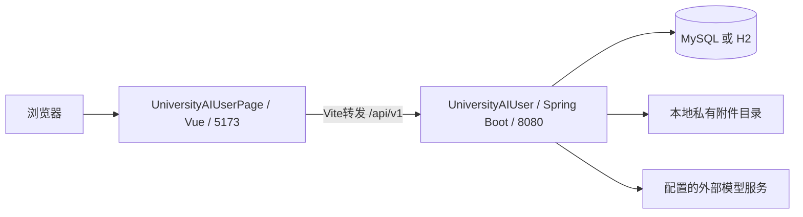

# 01 项目目录与分层

[返回文档目录](README.md)

## 目录

1. [项目整体关系](#项目整体关系)
2. [后端根目录](#后端根目录)
3. [src的目录含义](#src的目录含义)
4. [Java包的分层](#java包的分层)
5. [resources逐项说明](#resources逐项说明)
6. [数据库文件之间的关系](#数据库文件之间的关系)
7. [开发配置与提交范围](#开发配置与提交范围)

## 项目整体关系

这是前后端分离项目：前端负责浏览器界面、表单输入、路由及调用接口；后端负责身份认证、业务规则、数据库和外部模型调用。



`5173`是开发前端端口，`8080`是后端端口，MySQL默认连接`3306`。生产部署使用Nginx等服务，不依赖Vite开发服务器。

后端技术以当前`pom.xml`为准：Java 17、Spring Boot 3.3.5、Spring Web、Spring JDBC、Spring Security密码与JWT组件、Flyway、MySQL/H2、Jackson、JSON Schema校验组件、Spring Boot Test。项目引入的是安全相关组件，具体认证检查主要由自定义`SessionFilter`完成，不应误认为所有行为都由默认Spring Security过滤器链自动处理。

## 后端根目录

```text
UniversityAIUser/
├─ pom.xml                  Maven依赖、Java版本、构建配置
├─ src/                     后端源代码、资源和自动化测试
├─ scripts/                 PowerShell启动、初始化和验证脚本
├─ .run/                    可共享的IDEA运行配置
├─ database/                数据库SQL、模型和设计交付物
├─ contracts/               OpenAPI契约及验证记录
├─ apifox/                  API调试与批量验证集合
├─ docs/                    使用、设计、验证及本组源码说明
├─ frontend/                仓库内较旧的前端副本
├─ .local-data/             本机数据库、密钥、连接配置、附件及临时联调文件
├─ .tools/                  本机工具和依赖缓存
├─ .mvn/                    Maven相关目录；是否有包装器以实际文件为准
├─ .idea/                   IDEA本机工程设置
├─ .vscode/                 仓库内VS Code设置
├─ target/                  Maven生成的class、jar和测试报告
├─ .env.example             环境变量名称示例，不是真实凭据
├─ docker-compose.yml       数据库容器等本地环境配置
└─ README.md                项目入口说明
```

| 目录／文件 | 什么时候查看 | 是否用于直接执行业务 |
| --- | --- | --- |
| `src/main/java/` | 修改接口、安全、业务、数据库或定时任务 | 是 |
| `src/main/resources/` | 修改运行配置、契约或数据库迁移 | 是 |
| `src/test/` | 验证回归、理解预期输入输出 | 测试时使用 |
| `contracts/` | 协作时确认接口规范 | 是契约源材料，运行时读取的是resources中的副本 |
| `database/model/` | 查看SQL、PDM模型、Word设计说明等 | 设计交付物不会因为放在此处就自动执行 |
| `apifox/` | 外部接口调试、批量验证 | 不参与普通请求调用 |
| `target/` | 找jar、class、Surefire测试报告 | 自动生成，应通过构建更新 |
| `.local-data/` | 本机连接、JWT密钥、H2文件及附件 | 部分文件运行时读取，目录不提交Git |
| `frontend/` | 对照历史前端 | 本次实际联调不使用它 |

## src的目录含义

```text
src/
├─ main/
│  ├─ java/com/kaoyan/ai/    生产Java代码
│  └─ resources/            打包进入classpath的配置和资源
└─ test/
   ├─ java/com/kaoyan/ai/    自动化测试Java代码
   └─ resources/            只供测试环境使用的配置
```

`main`指正式应用代码，不是Git的main分支。`test`的内容不会作为普通业务逻辑执行。`resources`不是另一个Java包：例如`application.yml`是配置，SQL迁移是Flyway执行的数据库脚本。

`com/kaoyan/ai`对应包名`com.kaoyan.ai`，不对应浏览器URL。URL由控制器的`@GetMapping`、`@PostMapping`等注解决定。

## Java包的分层

| 包 | 中文职责 | 核心文件 | 主要调用方向 |
| --- | --- | --- | --- |
| 包根目录 | 应用启动 | `KaoyanAiApplication` | 启动Spring、扫描组件、启用调度 |
| `controller` | HTTP入口层 | `SupportController`、11个模块控制器、`AuthController` | 接收HTTP请求，转交执行器或认证Service |
| `security` | 身份与请求安全 | `SessionFilter`、`SessionService`、`AuthService`、`JwtService` | 在业务前检查身份、来源、CSRF，处理密码及JWT |
| `contract` | 接口规范与统一执行 | `ContractRegistry`、`ApiExecutor` | 校验请求，控制事务、幂等、返回格式，转交业务 |
| `domain` | 业务规则层 | `DomainDispatcher`、各业务Service、`DomainContext` | 根据操作执行规则，读取或更新业务数据 |
| `persistence` | 数据访问层 | `RecordRepository`等 | 使用JdbcTemplate执行SQL |
| `jobs` | 后台任务与推送 | `JobWorker`、`JobService`、定时任务等 | 消费任务、处理超时、生成提醒及事件 |
| `ai` | 外部模型适配层 | `ModelGateway` | 发送模型请求并校验模型输出 |
| `storage` | 私有附件层 | `FileService`、`AudioInspector` | 上传、下载、文件权限及音频时长校验 |
| `common` | 公共基础能力 | `Jsons`、`ApiException`、`ApiAdvice` | JSON工具、业务异常和统一错误处理 |

这里的`domain`相当于主要Service业务层；没有必要为了套用“controller/service/dao”命名而另找不存在的`service`或`dao`目录。Repository是当前项目的数据访问职责所在。

## resources逐项说明

```text
src/main/resources/
├─ application.yml
├─ application-local.yml
├─ application-mysql.yml
├─ application-dev.yml
├─ application-prod.yml
├─ contract/openapi.json
├─ db/migration/
│  ├─ h2/
│  │  ├─ V1__initial_schema.sql
│  │  └─ V2__jwt_sessions.sql
│  └─ mysql/
│     ├─ V1__initial_schema.sql
│     └─ V2__jwt_sessions.sql
├─ mapper/.gitkeep
└─ static/
   ├─ contract/openapi.json
   └─ assets/avatar.svg
```

| 文件 | 具体作用 |
| --- | --- |
| `application.yml` | 公共配置：应用名、默认local环境、127.0.0.1:8080、上传大小、会话Cookie、JWT有效期、CORS允许来源、模型参数等。`${变量:默认值}`表示从配置环境解析变量。 |
| `application-local.yml` | H2文件数据库，Flyway使用h2迁移；启用本地种子数据。首次种子初始化需要明确设置演示密码。`start-auth-local.ps1`会覆盖为不初始化种子账号。 |
| `application-mysql.yml` | 本机MySQL；导入Git忽略的`mysql-local.properties`与`auth-local.properties`，自动读取本机连接参数和JWT密钥。 |
| `application-dev.yml` | MySQL开发配置，从环境／配置属性读取连接参数；不自动导入mysql profile的本机属性文件。 |
| `application-prod.yml` | MySQL生产配置，开启会话Cookie的Secure；JWT服务也复用此Secure属性。部署时还需要配置可信来源、HTTPS及密钥。 |
| `contract/openapi.json` | 后端`ContractRegistry`实际读取的业务契约；定义81个既有操作的参数、模型、返回和幂等约束。 |
| `static/contract/openapi.json` | 提供给HTTP客户端和Swagger UI查看的静态契约副本。修改契约应保持相关副本一致。 |
| `V1__initial_schema.sql` | 初始账号表、各业务聚合表、幂等及事件表。h2/mysql分开适配数据库方言。 |
| `V2__jwt_sessions.sql` | 新建`auth_tokens`令牌状态表及到期时间索引。 |
| `mapper/.gitkeep` | 让空目录能保留在Git中；没有Mapper XML或Mapper接口实现。 |
| `static/assets/avatar.svg` | 静态数字人形象素材，与私有上传附件不是同一类文件。 |

配置加载方式：公共配置加选中的profile。IDEA的`KaoyanAi MySQL`通过`--spring.profiles.active=mysql --server.port=8080`选择MySQL。默认直接运行主类会落到local配置，不能据此认定使用的是MySQL。

`.local-data/auth-local.properties`是本机开发配置，不是resources内容，也不会自动打包给其他开发者。`setup-local-auth.ps1`用于首次生成；生产环境使用独立密钥。`.env.example`只作示例，Spring不会因为文件叫.env就自动读取它。

## 数据库文件之间的关系

| 位置 | 定位 |
| --- | --- |
| `src/main/resources/db/migration/` | 应用启动时由Flyway按版本执行；这是自动迁移的实际入口 |
| `database/create-database.mysql.sql` | 数据库初始化／创建环境的辅助SQL，按文件内容和原有说明手工使用 |
| `database/model/01_schema.mysql.sql` | 数据库结构设计交付物，用于建模、审阅及指定环境初始化 |
| `database/model/02_demo_data.mysql.sql` | 样例数据交付物，不代表真实院校或真实业务事实 |
| `database/model/*.pdm` | 数据库建模工具的模型文件 |
| `database/model/*.docx`、说明及记录 | 数据库设计文档与验证材料 |

不要同时手工执行建表脚本再无条件运行同一版本Flyway迁移。已应用的V1/V2不应随意修改；后续表结构调整新增V3等迁移。已存在但没有Flyway历史的库，需要按原数据库接入流程建立基线。

`RecordRepository`对很多业务表采用“公共列＋JSON payload”存储：公共列包括id、owner_id、version、时间，细节在payload文本中。它既不是把所有业务塞进一张表，也不是把每个业务字段都拆成关系型列。账号、令牌、幂等及事件表还有各自专用结构。

## 开发配置与提交范围

| 文件类别 | 建议 |
| --- | --- |
| Java源码、resources配置模板、数据库迁移、测试、文档 | 应提交 |
| `.run/KaoyanAi MySQL.run.xml` | 可提交，当前只含启动参数和项目相对工作目录，不应加入密钥 |
| `.env.example` | 可提交变量名及空值／安全默认值 |
| `.local-data/`、真实.env文件 | 不提交，可能含密钥、密码、私有附件和本机数据库 |
| `.idea/`本机缓存、`target/`、`.tools/` | 通常不提交 |
| 前端`node_modules/`、`dist/`、测试运行产物 | 不作为源代码提交 |

两套前端并存时，先核对当前编辑器打开的路径。当前使用的是桌面`UniversityAIUserPage`，修改后端仓库中的旧`frontend/`不会自动影响桌面项目。
