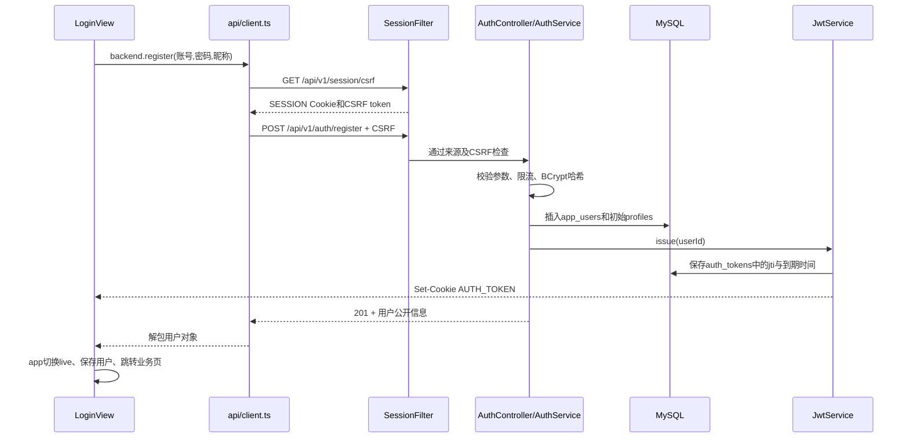
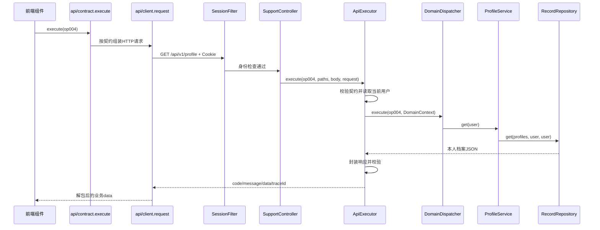
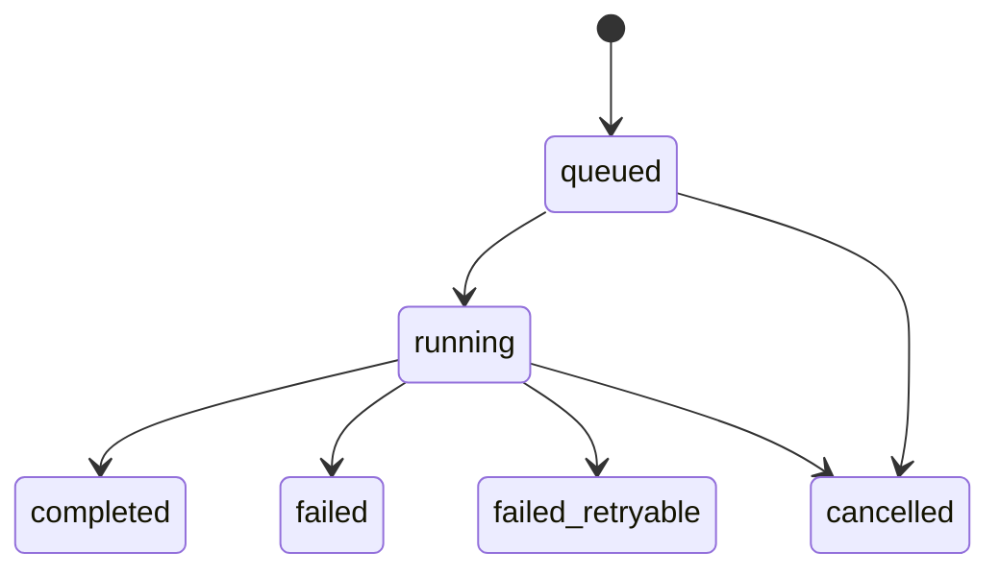

# 03 完整交互流程

[返回文档目录](README.md)

## 目录

1. [启动时各组件如何准备](#启动时各组件如何准备)
2. [打开网页与路由保护](#打开网页与路由保护)
3. [注册和自动登录](#注册和自动登录)
4. [登录恢复与退出](#登录恢复与退出)
5. [一个普通业务请求](#一个普通业务请求)
6. [AI及其他异步任务](#ai及其他异步任务)
7. [练习模考计划之间的关联](#练习模考计划之间的关联)
8. [附件上传与识别](#附件上传与识别)
9. [事件通知与SSE](#事件通知与sse)
10. [错误如何回到页面](#错误如何回到页面)
11. [修改功能时沿哪条链查](#修改功能时沿哪条链查)

## 启动时各组件如何准备

```text
IDEA运行 KaoyanAi MySQL
  → main启动Spring Boot
  → 读取application.yml和application-mysql.yml
  → 读取本机mysql-local.properties及auth-local.properties
  → 创建数据源，连接MySQL
  → Flyway检查迁移历史，应用尚未执行的迁移
  → ContractRegistry加载OpenAPI，JwtService准备签名与校验器
  → LocalDataInitializer按seed开关决定是否准备样例
  → Web服务就绪，JobRecovery处理遗留running任务
  → 计划任务按间隔轮询
```

这是概念上的依赖顺序，Spring内部Bean创建及生命周期事件可能交错，不能把它当作逐行日志的固定顺序。数据库和契约加载失败时，应用可能无法启动；必须看到启动成功日志后才认为8080服务可用。

前端是独立进程：VS Code终端运行`npm run dev`，Vite提供5173页面，并代理`/api/v1`到8080。Java主类不会替你启动VS Code里的Vite，Vite也不会自动启动MySQL或Spring Boot。

## 打开网页与路由保护

```text
浏览器请求前端根地址 /
  → main.ts挂载Vue、Pinia和Router
  → router将 / 重定向到 /login
  → App.vue发现当前是登录路由
  → RouterView展示LoginView.vue
```

LoginView负责输入、前端基础校验、提交状态、错误展示、注册／登录切换以及萤火虫动画。动画不会触发后端请求。登录后去哪个页面由路由参数redirect及安全的站内路径检查决定。

直接访问受保护业务页时，若处于live模式且尚未恢复身份，路由守卫尝试调用`backend.currentUser()`，即`GET /auth/me`；成功则恢复app.user，失败则进入/login。demo模式是用户明确进入的本地演示路径，不等于取得后端授权；后端接口仍自行验证身份。

## 注册和自动登录



分步骤对应源码：

1. `LoginView.submit()`检查账号格式、密码字节长度和两次密码是否一致。前端校验只是改善体验，不能代替后端检查。
2. `api/backend.ts`调用`request('/auth/register', ...)`。这些新增认证请求直接调用HTTP客户端，不经过旧`execute('op002')`。
3. `api/client.ts`在写请求前确保已取得CSRF，fetch设置`credentials: 'include'`，由浏览器带上Cookie。
4. `SessionFilter`允许未登录访问注册路由，但仍要求有效CSRF和来源；因此“公开接口”不表示任何来源都可以无检查写入。
5. `AuthService.authenticate(..., true, ...)`规范化账号并检查密码／昵称，生成BCrypt哈希，调用`UserAccountRepository.create()`。
6. 注册事务还调用`RecordRepository.create('profiles', ...)`建立初始备考档案，避免账号建立后读取档案404。
7. 数据库`login_name`唯一约束保证重复账号最终被拒绝，即使请求并发；异常被转为409及明确提示。
8. 成功时轮换会话ID，清理旧CSRF与旧会话身份，撤销已有JWT，签发新JWT。账号、档案与令牌记录在该事务内组织。
9. 浏览器处理HttpOnly Cookie，前端只取得公开的id、loginName、displayName，并映射为User的nickname用于界面。
10. 前端清理缓存CSRF。下一次写请求重新获取，匹配服务端轮换后的状态。

数据库里的密码是哈希，不是前端输入原文；JWT正文不包含密码或密码哈希。注册接口返回用户公开信息，JWT通过Cookie传递。

## 登录恢复与退出

### 登录

`LoginView → backend.login → client.request → SessionFilter → AuthController.login → AuthService.authenticate(false) → UserAccountRepository.findByLoginName → BCrypt.matches → JwtService.issue`。

账号不存在时也会用虚拟哈希执行比较，减小根据密码比较时间识别账号存在与否的差异；失败返回“账号或密码错误”。登录成功只在浏览器应用中设置前端状态还不够，真正的后端身份依据是携带并通过校验的Cookie／令牌。

### 页面刷新恢复

刷新会重新创建内存中的Pinia状态，因此app.user起初为空。但AUTH_TOKEN Cookie还存在，路由守卫通过`GET /api/v1/auth/me`恢复用户。后端链路为：

```text
SessionFilter
  → SessionService.user()
  → JwtService.token()读取JWT
  → JwtService.verify()验证签名、声明及数据库令牌状态
  → AuthController.me()
  → AuthService.current()
  → UserAccountRepository.findById()
  → 返回当前用户
```

同一请求可能在Filter及Service中多次读取身份。默认JWT有效期30分钟，是固定到期时间；当前没有实现刷新令牌接口，也不因每次访问自动延长JWT。

### 退出

`App.logout → backend.logout → POST /auth/logout → SessionFilter校验身份和CSRF → AuthController → JwtService.revoke → 删除auth_tokens记录 → 清AUTH_TOKEN Cookie → SessionService.logout销毁会话 → 前端清用户并返回登录页`。

只在前端把`app.user`置空不算完整退出；当前实际退出入口会请求后端撤销。对于已经过期的令牌，后端可能直接返回401，前端鉴权失效处理会清理界面状态；不能把401当作网络连接失败。

### 旧会话接口

`/session/login`及`/session/logout`是原契约op002／op003，使用SessionService的旧会话机制。新登录页使用`/auth/*`。查代码时先确认调用的是哪一套，不能把旧接口的userId写入方式套用到新JWT登录。

## 一个普通业务请求

以读取本人备考档案`GET /api/v1/profile`、op004为例：



请求体、查询、路径、身份的区别：

| 信息 | 来源 | 例子 |
| --- | --- | --- |
| path参数 | URL路径模板 | `/jobs/{id}`里的任务id |
| query参数 | URL问号后 | 分页、科目、年度筛选 |
| body | POST／PUT／PATCH等请求的JSON或表单 | 档案修改内容、答案、计划预算 |
| user | 服务端从认证凭据解析 | 当前账号id，不直接信任客户端声称的owner |
| operationId | Controller绑定及OpenAPI定义 | op004、op045，用于内部找到对应操作 |

写操作还会校验CSRF、用户锁、可能的幂等键和业务版本。请求相同不表示就能无条件重复写入：是否幂等、是否允许重试由契约及业务状态决定。

## AI及其他异步任务

AI生成、评分等可能耗时，因此部分接口不会直接返回最终结果，而是返回HTTP 202及任务标识。

以答疑op039为例：

```text
ContractWorkspace提交答疑
  → contract.execute(op039)，携带需要的幂等键及上下文版本
  → Module05Controller
  → ApiExecutor
  → DomainDispatcher识别为异步操作
  → QaService.prepareMessage检查会话并准备消息
  → JobService.enqueue保存jobs和job_commands
  → 返回202、jobId、resultUrl

JobWorker每500ms检查任务
  → 在事务内将queued变成running
  → 从job_commands恢复DomainContext
  → DomainDispatcher.complete组织学习上下文
  → ModelGateway请求外部模型并校验结构
  → 在新事务内核对任务是否取消
  → persistModelResult保存业务结果
  → 更新job为completed并保存result
  → EventService发布事件

前端waitJob(jobId)
  → 使用op009反复查询本人任务
  → completed：读取job.result并渲染
  → failed / failed_retryable / cancelled：显示相应状态
```

任务状态常见转换：



这些状态需要结合具体操作的返回Schema理解，不能假设每个资源都使用完全相同字段。`failed_retryable`表示可以重新提交，不代表系统必定后台无限重试。

模型调用放在数据库提交事务之外，可避免等待网络时长期占用业务事务；提交前重新读取状态，防止用户取消后，迟到的模型结果又覆盖页面。

前端`waitJob`最多轮询90次且受约120秒总期限限制，间隔逐渐增加。界面轮询超时不必然表示后台任务失败，可稍后按任务ID查询。SSE和轮询是两种不同机制，当前JWT持续SSE存在第2篇所述的兼容边界。

异步不等于一定调用模型：候选计划、部分统计／规则评估也是任务化处理。没有校准的录取样本时，系统返回insufficient_data及空概率，不能把占位风险说明当作已计算的可靠录取概率。

## 练习模考计划之间的关联

### 练习与错题

1. CatalogService提供带版本的题目资料。
2. PracticeService创建本人练习会话，记录本次题目。
3. 提交作答后，按题目版本评分并保存attempts。
4. 错题和作答历史进入wrong_items等记录。
5. AnalyticsService依据作答和学习事件统计掌握情况，而不是只根据页面显示了多少题计算成绩。

题目答案和解析不能无条件提前暴露：界面取题、交卷和结果查询需要遵循对应契约和Service中的展示规则。

### 模考

`CatalogService试卷列表 → ExamService开考并记录deadlineAt → 保存／恢复答案 → 用户交卷或ExamDeadlineService按服务端时间触发收卷 → op061创建评分任务 → JobWorker评分 → ExamService.saveResult → 成绩／排名查询`。

服务端截止时间才决定考试是否结束。前端倒计时只是展示，关闭页面不等于暂停考试。试卷版本、作答版本、考试会话版本、成绩快照是不同对象，不能混用。

### 计划

`ProfileService读取个人档案 → PlanService按基础和每天时间生成候选 → 用户检查／修改 → 确认后active → 完成任务及记录学习事实 → progress和AnalyticsService汇总 → ReminderService按设置提醒 → 必要时生成调整方案`。

生成候选不等于立即替换生效计划；确认接口是重要状态边界。学习任务完成、实际学习时长、练习成绩也不是同一指标。

## 附件上传与识别

```text
浏览器选择文件
  → client.request发送FormData（不手工写multipart boundary）
  → SessionFilter鉴权和CSRF
  → SupportController上传入口
  → FileService检查用途、大小、内容／类型
  → 音频额外使用AudioInspector校验实际时长
  → 磁盘保存私有文件，数据库保存files元数据
  → 前端取得fileId
  → 将fileId提交给图片识别或语音互动接口
  → DomainDispatcher通过FileService按本人和用途读取
  → ModelGateway识别图片或转写音频
```

fileId不是任意文件路径。下载接口由FileService校验所有者后返回二进制，不能把本机私有磁盘路径直接当公开URL发给浏览器。截图识题识别结果还需要用户核对，再进入后续答疑流程，避免把识别错误直接当作准确题意。

## 事件通知与SSE

`EventService.publish()`组织事件并写event_outbox；`EventService.notify()`另外写notifications。前者是事件传递账本，后者是用户可见的站内通知，两者不应混淆。

前端`subscribeEvents()`创建EventSource，后端`subscribe()`处理Last-Event-ID及连接，`deliver()`周期性发送用户游标后的事件并维持心跳。前端对事件类型、结构和eventId去重，重连时可重新拉取状态。

当前事件服务仍依赖旧会话身份判断，新JWT流程没有写入相同userId会话属性。这是当前实现边界，不应在答辩或说明中声称JWT的SSE已完成持续鉴权适配。普通HTTP查询和异步任务轮询不依赖这段deliver身份检查。

## 错误如何回到页面

```text
过滤器拒绝 → SessionFilter直接写JSON
控制器／服务异常 → ApiAdvice转换为JSON
数据库／未知异常 → 服务端日志记录traceId，前端收到一般错误
前端client → ApiError
useLoad或ContractWorkspace → 页面错误与重试状态
```

| 状态 | 常见含义 | 首先查看 |
| --- | --- | --- |
| HTTP 000、连接拒绝、代理502等 | 服务没启动、端口错误、代理不可达或网络问题 | IDEA启动日志、VS Code Vite日志、8080／5173端口 |
| 400 | 不符合契约、无效JSON、参数类型等 | request body、query、operation定义 |
| 401 | 未登录、凭据错误或JWT过期／撤销 | 登录响应、Cookie、auth/me、新旧认证入口 |
| 403 | CSRF不匹配或来源不允许 | SESSION、CSRF轮换、请求头、Origin配置 |
| 404 | 资源不存在或不属于本人等 | 当前用户、资源id、owner |
| 409 | 重复账号、陈旧版本、幂等内容冲突或状态冲突等 | 业务code和message、版本及幂等键 |
| 422 | 业务参数不满足规则 | 账号、密码、日期、分数等校验条件 |
| 429 | 认证尝试、待处理任务或连接数超限 | Retry-After和对应限流逻辑 |
| 503／504 | 模型依赖不可用、模型结构错误或请求超时等 | ModelGateway配置、模型响应和后端日志 |

同一个状态码可能对应多种业务code，必须结合响应中的message和traceId定位。204代表成功但无响应体，前端client专门处理，不应强行解析JSON。

## 修改功能时沿哪条链查

| 想修改的内容 | 推荐定位顺序 |
| --- | --- |
| 登录卡片、背景、表单 | 前端LoginView → backend.ts → 新auth接口 |
| 密码或账号规则 | AuthService → 前端LoginView基础校验 → AuthIntegrationTests |
| JWT有效期、撤销、Cookie | application配置 → JwtService → SessionService／SessionFilter |
| 新增普通业务操作 | OpenAPI → Controller → ApiExecutor／DomainDispatcher → Service → Repository → 前端契约生成 → 测试 |
| 修改已有业务字段 | 所有相关契约副本 → 数据读取写入与Schema → 前端生成类型及UI → 回归测试 |
| 改数据库结构 | 新版本Flyway迁移 → Repository → 使用它的Service → 数据库测试 |
| 修改模型行为 | DomainDispatcher任务输入 → ModelGateway → 输出Schema → 结果持久化 → 模型流程测试 |
| 页面显示空列表 | 先确认live／demo → 请求状态 → 所选profile及数据库 → 真实资料是否存在 |

文档任务没有修改这些业务链路。本文说明的是本次检查到的实现，不代表所有外部模型、真实资料、生产部署与事件兼容均已配置完成。
